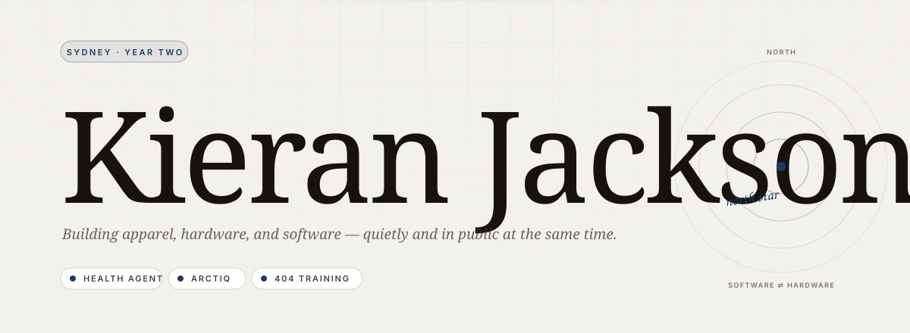

  

  
  
  

 

## Hey

I'm Kieran. I build things across software, hardware and apparel, usually more than one at a time. Almost everything I make lives here, and almost all of it is private. The public repos are the ones someone asked to see.

 

## Now

A year in. I came out of a Bachelor of Commerce (Finance) at Macquarie, taught myself to code, and have spent the year building for real. In that time I've:

- built patient portals for several big pharma companies
- built RFID inventory management
- written firmware for ESP32 hardware, and taken up 3D printing to house it
- shipped iOS and macOS apps in SwiftUI, and Android apps in Kotlin
- had a short run at posting on social media

A year ago I was a frontend developer. Now I'll take on whatever the idea needs: a portal, a device, an app. Right now I'm back to building in private.

 

## Built with Claude

This has been a year of design engineering, or vibe coding if you prefer. I design the thing and decide what it should feel like, then Claude and I build it together. Everything above came out of that. In September I built a dashboard to keep count across my three machines. Since then:

<table>
<tr>
<td align="center"><b>3,535</b> sessions</td>
<td align="center"><b>1.1M</b> lines written</td>
<td align="center"><b>2,360</b> commits</td>
<td align="center"><b>591</b> hours hands-on</td>
<td align="center"><b>40B</b> tokens</td>
</tr>
</table>

7 September to 12 November 2026, Claude Code on a Mac mini and two laptops.

 

## What I'm building

<table>
<tr>
<td width="33%" valign="top">

**Frontend Developer**
 healthagent.com.au

Pharma patient-assistance programs. Live and operational.

</td>
<td width="33%" valign="top">

**Director · Brand & Strategy**
 arctiqservices.com.au

Refrigeration for the vaccine cold chain. Black-box fridge monitors shipping now, next-gen compression R&D with Melbourne Uni.

</td>
<td width="33%" valign="top">

**Co-Founder · Technical Director**
 404training.com

Apparel + hardware brand. Cerebro was the first firmware drop.

</td>
</tr>
</table>

 

## iPhone apps

Two apps that do one job each, built in SwiftUI for iOS 26 with Claude. Both are open source under MIT.

<table>
<tr>
<td width="50%" valign="top">

<a href="https://github.com/KezLahd/jot"><picture><source media="(prefers-color-scheme: dark)" srcset="https://raw.githubusercontent.com/KezLahd/jot/main/docs/icon-dark.png"></picture></a>

**[Jot](https://github.com/KezLahd/jot)** · *Speech into words.*

Share a reel, a video or a voice memo and get a clean, timestamped transcript. For iPhone and Mac.

</td>
<td width="50%" valign="top">

<a href="https://github.com/KezLahd/cut"><picture><source media="(prefers-color-scheme: dark)" srcset="https://raw.githubusercontent.com/KezLahd/cut/main/docs/icon-dark.png"></picture></a>

**[Cut](https://github.com/KezLahd/cut)** · *Video into stills.*

Share a reel, a video or a recording of your screen, keep the frames worth keeping, and hand them to Claude.

</td>
</tr>
</table>

 

## Public on GitHub

### Shipped

| Repo | What it is |
|---|---|
|  | Frosted-glass React component kit: 69 components, installs with the shadcn CLI, themes with one CSS file. Live at [rime.mjsons.net](https://rime.mjsons.net). |
|  | ESP32-S3 firmware for the Cerebro voice-capture device — animated face, BLE pairing, Wi-Fi HTTP API, dual-codec audio. |
|  | Product landing page for Cerebro with a Preston Blair phonetic lip-sync on the hero face. |
|  | TrackMan 4 → Dolphin bridge. Swing a real golf club at the radar; the Wiimote in Wii Sports Resort Golf swings with you. Synthetic MotionPlus IMU over cemuhook DSU. |
|  | Web portal for GridAlert, Arctiq's real-time electricity-outage alerting platform — Next.js + Supabase + PostGIS with multi-tenant RLS. |
|  | Windows desktop app that composites your screen + webcam + logo into one resizable window. Python + PyQt6, 2.8k lines. |

### Shelved, kept as receipts

| Repo | What it is |
|---|---|
|  | A content OS I built before I understood that you don't build a content habit by building a content OS. Kept as chapter zero. |
|  | AI-voice SaaS for real-estate agents. The tech shipped; the compliance moat to sell it didn't. |

### Personal / internal

| Repo | What it is |
|---|---|
|  | Private PWA itinerary app for four mates through Europe. No public landing — this repo is the landing. |
|  | A tiny two-person task board my mate and I built so we could stay out of each other's way while vibe-coding our first projects together. |

More may come public as projects graduate out of "learning" and into "ready to show." The rest stay private on purpose — not because they're secret, because they're not good yet.

 

## What I build with

  
  
  
  
  

  
  
  
  

  
  
  
  
  

  
  
  
  
  

 

## Reach me

  
  
  

 

---

  Sydney · 2026 · <b>Most repos private.</b> The public ones are the ones you asked to see.
   
  Another <a href="https://instagram.com/kieranjxn">Kez Curation ↗</a>

