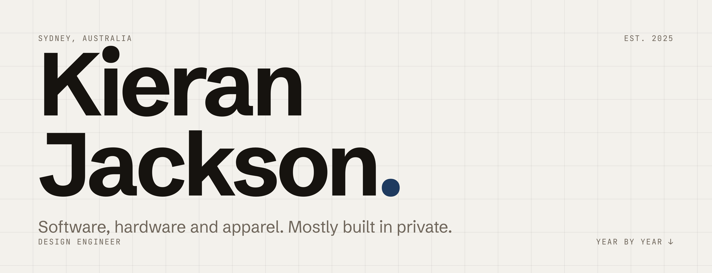
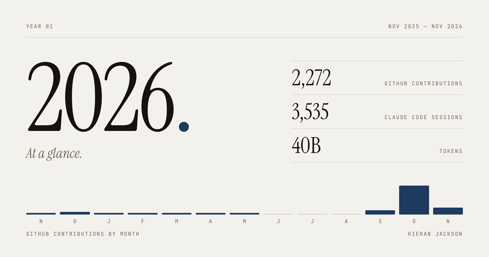
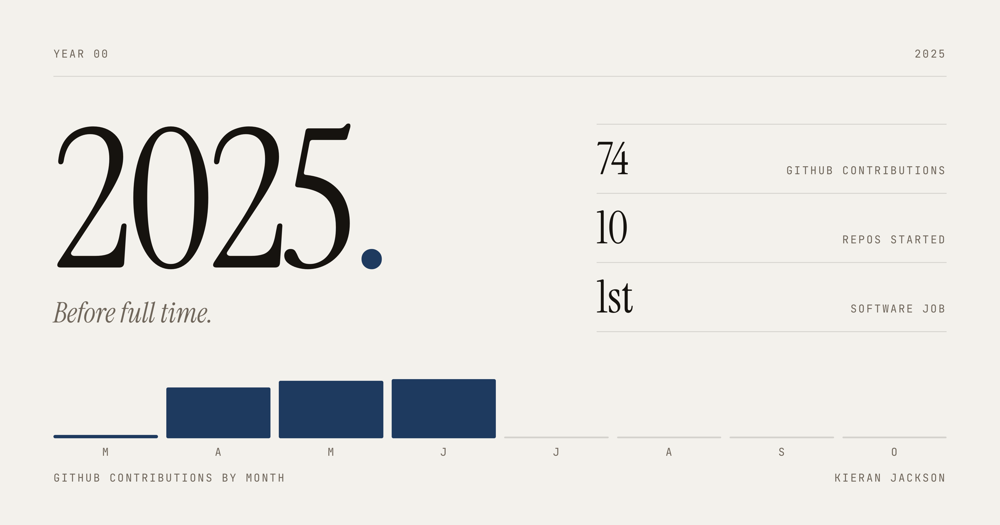

<picture>
  <source media="(prefers-color-scheme: dark)" srcset="assets/hero-dark.png">
  
</picture>

I'm Kieran. I design things and build them, usually more than one at a time: web portals, firmware, phone apps and clothes. Almost all of it lives in private repos. The public ones are the ones someone asked to see.

Once a year I write down what I built.

 

<a href="years/2026.md">
  <picture>
    <source media="(prefers-color-scheme: dark)" srcset="assets/years/2026-dark.png">
    
  </picture>
</a>

<a href="years/2026.md"><b>Read 2026 at a glance →</b></a> Year one, full time

 

<a href="years/2025.md">
  <picture>
    <source media="(prefers-color-scheme: dark)" srcset="assets/years/2025-dark.png">
    
  </picture>
</a>

<a href="years/2025.md"><b>Read 2025 →</b></a> Before full time

 

---

Sydney · <a href="https://instagram.com/kieranjxn">@kieranjxn</a>

