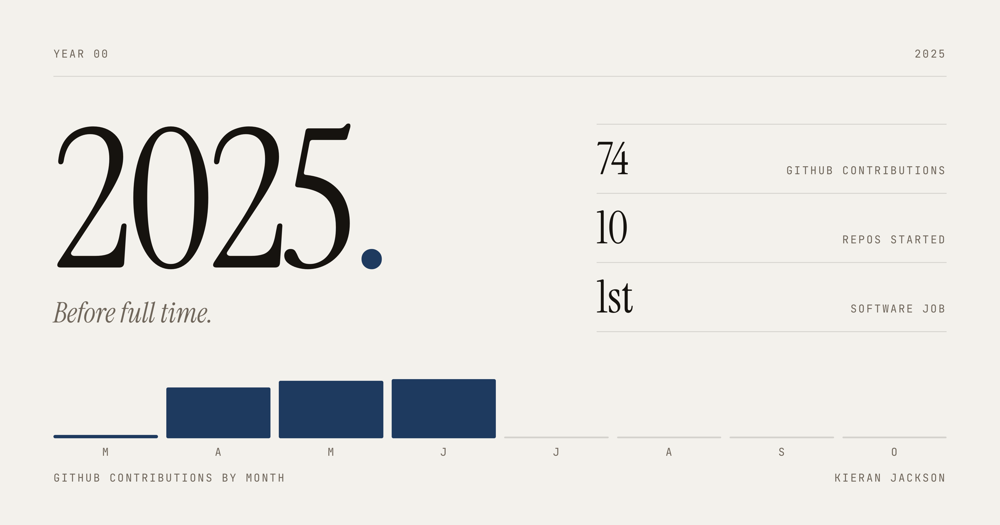
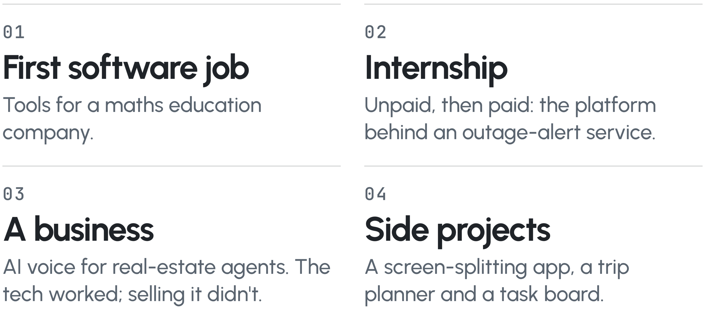
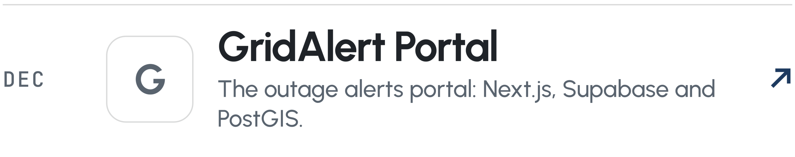
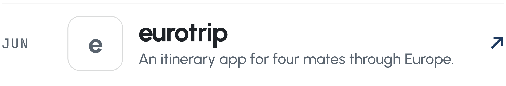
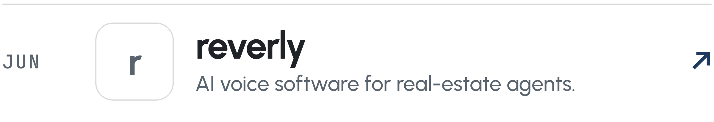
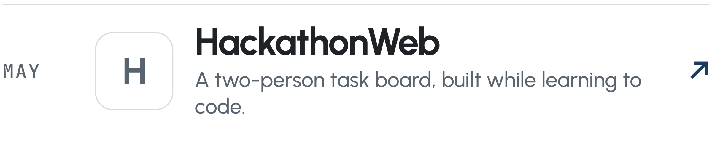
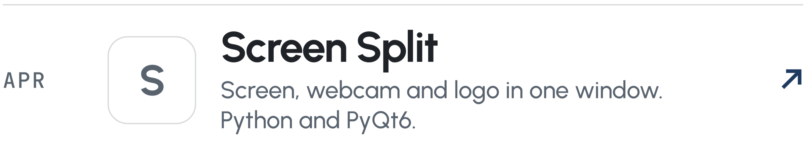
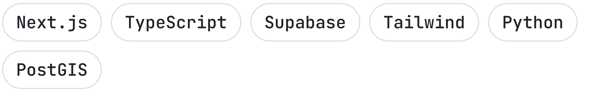

<a href="../README.md">← Kieran Jackson</a>

<picture>
  <source media="(prefers-color-scheme: dark)" srcset="../assets/years/2025-dark.png">
  
</picture>

# 2025

**Year zero: the months before full time.**

I'd just finished a Bachelor of Commerce (Finance) and taught myself enough code to be useful. A first software job, an internship that turned into paid work, and a business that didn't work out. Then a quiet few months, a busy November, and the full-time job from 1 December.

## The work

<picture>
  <source media="(prefers-color-scheme: dark)" srcset="../assets/years/2025/work-dark.png">
  
</picture>

## Built in public

<a href="https://github.com/KezLahd/GridAlertPortal">
<picture>
  <source media="(prefers-color-scheme: dark)" srcset="../assets/years/2025/project-0-dark.png">
  
</picture>
</a>
<a href="https://github.com/KezLahd/eurotrip">
<picture>
  <source media="(prefers-color-scheme: dark)" srcset="../assets/years/2025/project-1-dark.png">
  
</picture>
</a>
<a href="https://github.com/KezLahd/reverly">
<picture>
  <source media="(prefers-color-scheme: dark)" srcset="../assets/years/2025/project-2-dark.png">
  
</picture>
</a>
<a href="https://github.com/KezLahd/HackathonWeb-nr">
<picture>
  <source media="(prefers-color-scheme: dark)" srcset="../assets/years/2025/project-3-dark.png">
  
</picture>
</a>
<a href="https://github.com/KezLahd/Screen-Split">
<picture>
  <source media="(prefers-color-scheme: dark)" srcset="../assets/years/2025/project-4-dark.png">
  
</picture>
</a>

Plus seven private repos.

## What I built with

<picture>
  <source media="(prefers-color-scheme: dark)" srcset="../assets/years/2025/tools-dark.png">
  
</picture>

 

<a href="2026.md">2026 at a glance →</a>
