<a href="../README.md">← Kieran Jackson</a>

<picture>
  <source media="(prefers-color-scheme: dark)" srcset="../assets/years/2026-dark.png">
  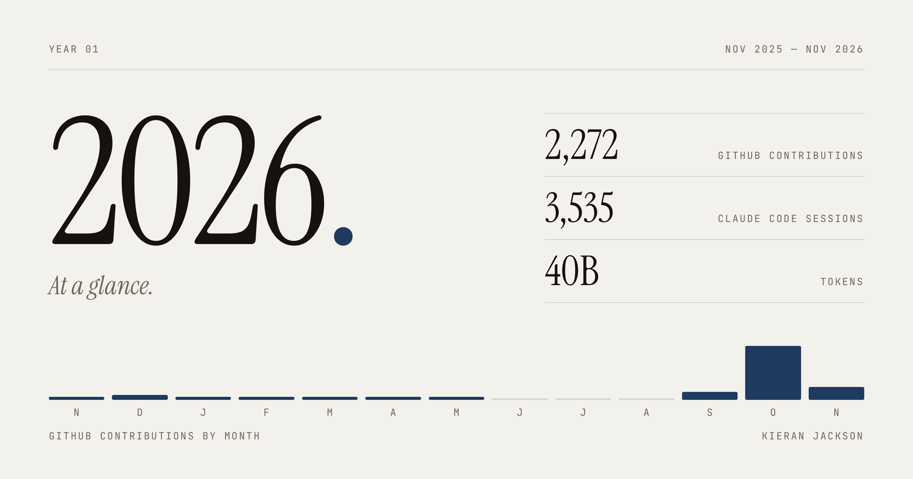
</picture>

# 2026 at a glance

**Year one of doing this full time, 1 December 2025 to November 2026.**

A year ago I was a frontend developer. I'd come out of a Bachelor of Commerce (Finance) at Macquarie and taught myself to code. This year I stopped picking work by what I already knew, and started taking on whatever the idea needed.

## The work

<picture>
  <source media="(prefers-color-scheme: dark)" srcset="../assets/years/2026/work-dark.png">
  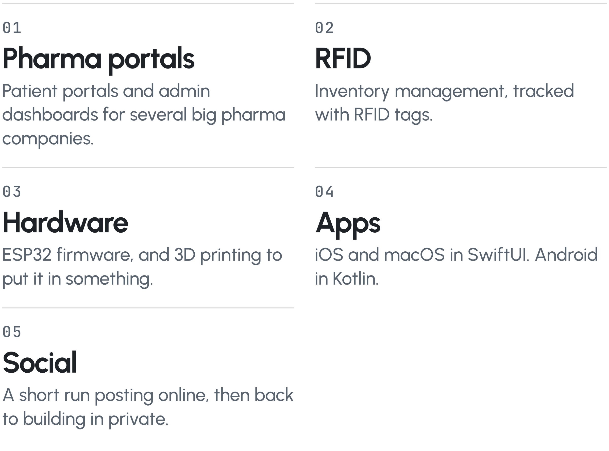
</picture>

## Where

<a href="https://healthagent.com.au">
<picture>
  <source media="(prefers-color-scheme: dark)" srcset="../assets/years/2026/role-0-dark.png">
  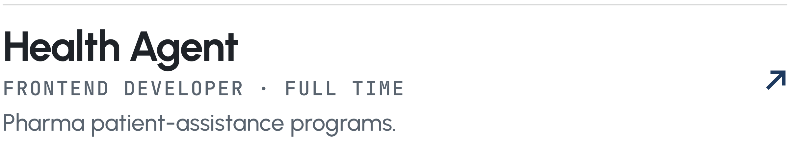
</picture>
</a>
<a href="https://arctiqservices.com.au">
<picture>
  <source media="(prefers-color-scheme: dark)" srcset="../assets/years/2026/role-1-dark.png">
  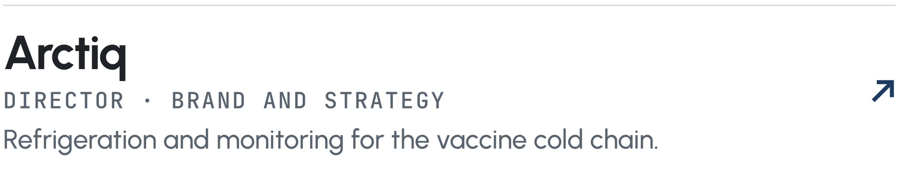
</picture>
</a>
<a href="https://404training.com">
<picture>
  <source media="(prefers-color-scheme: dark)" srcset="../assets/years/2026/role-2-dark.png">
  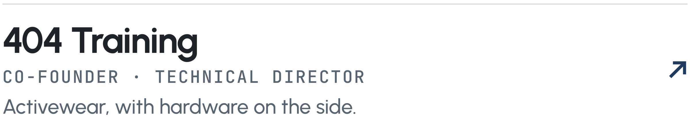
</picture>
</a>

## Built in public

<a href="https://github.com/KezLahd/jot">
<picture>
  <source media="(prefers-color-scheme: dark)" srcset="../assets/years/2026/project-0-dark.png">
  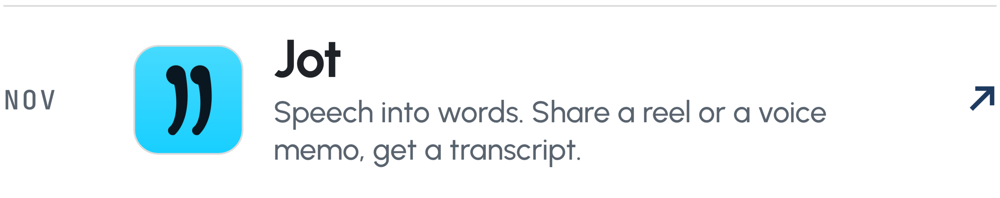
</picture>
</a>
<a href="https://github.com/KezLahd/cut">
<picture>
  <source media="(prefers-color-scheme: dark)" srcset="../assets/years/2026/project-1-dark.png">
  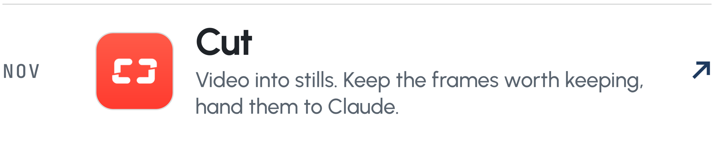
</picture>
</a>
<a href="https://github.com/KezLahd/rime">
<picture>
  <source media="(prefers-color-scheme: dark)" srcset="../assets/years/2026/project-2-dark.png">
  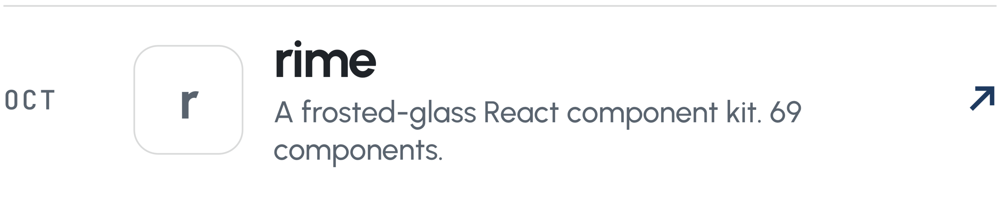
</picture>
</a>
<a href="https://github.com/KezLahd/Wii-Golf-x-Trackman">
<picture>
  <source media="(prefers-color-scheme: dark)" srcset="../assets/years/2026/project-3-dark.png">
  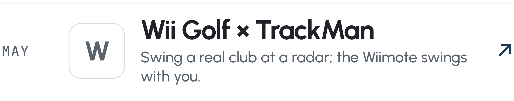
</picture>
</a>
<a href="https://github.com/KezLahd/cerebro-firmware">
<picture>
  <source media="(prefers-color-scheme: dark)" srcset="../assets/years/2026/project-4-dark.png">
  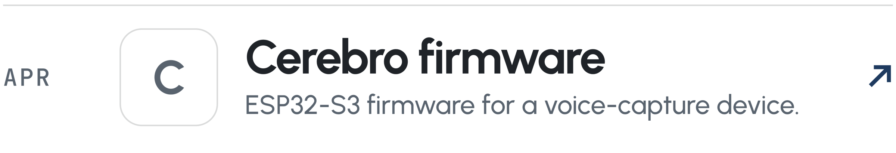
</picture>
</a>
<a href="https://github.com/KezLahd/cerebro">
<picture>
  <source media="(prefers-color-scheme: dark)" srcset="../assets/years/2026/project-5-dark.png">
  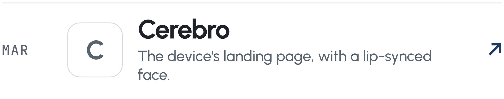
</picture>
</a>
<a href="https://github.com/KezLahd/atlas-legacy">
<picture>
  <source media="(prefers-color-scheme: dark)" srcset="../assets/years/2026/project-6-dark.png">
  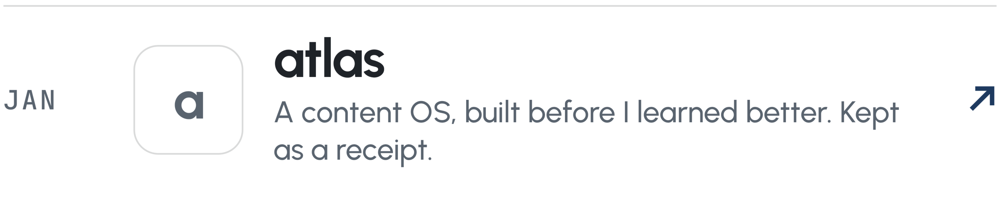
</picture>
</a>

Plus six private repos.

## Built with Claude

A year of design engineering, or vibe coding if you prefer. I design the thing and decide how it should feel, then Claude and I build it together.

<picture>
  <source media="(prefers-color-scheme: dark)" srcset="../assets/years/2026/claude-dark.png">
  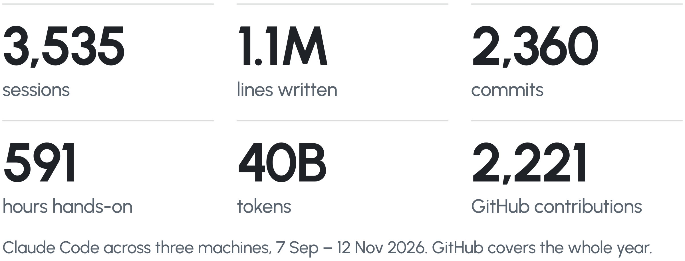
</picture>

## Picked up this year

<picture>
  <source media="(prefers-color-scheme: dark)" srcset="../assets/years/2026/tools-dark.png">
  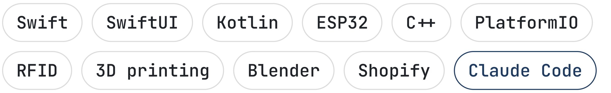
</picture>

 

<a href="2025.md">← 2025</a>
